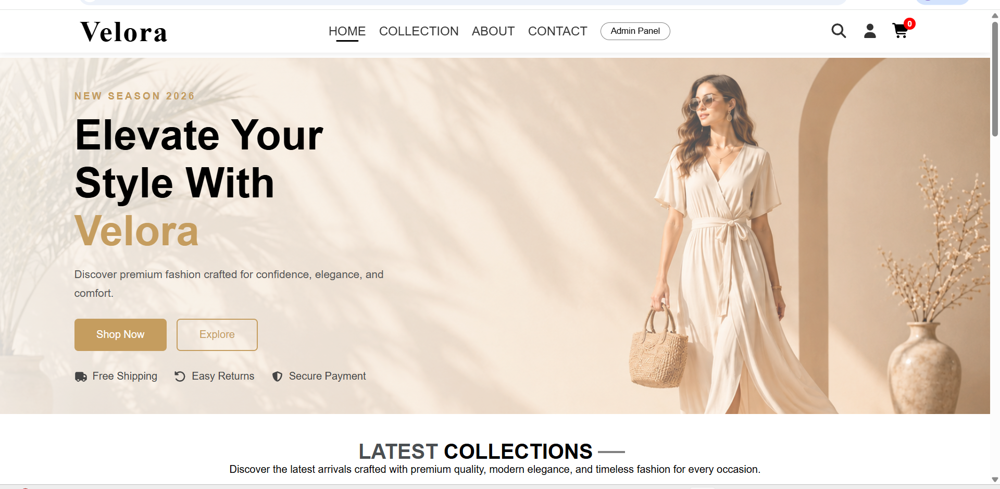
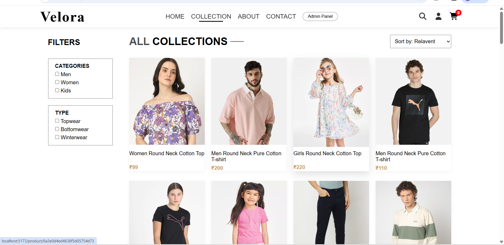
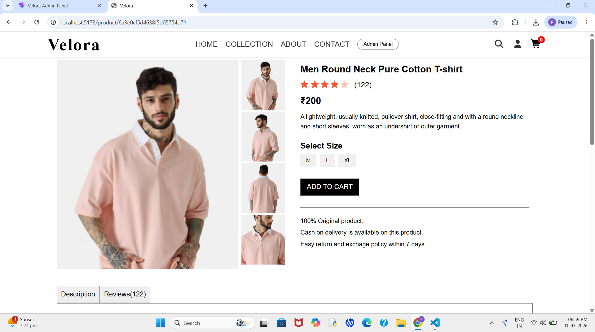
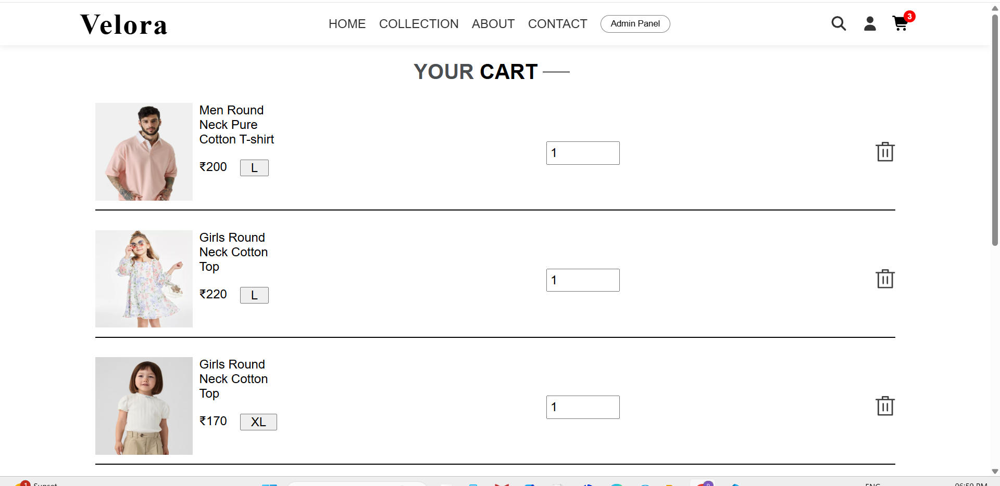
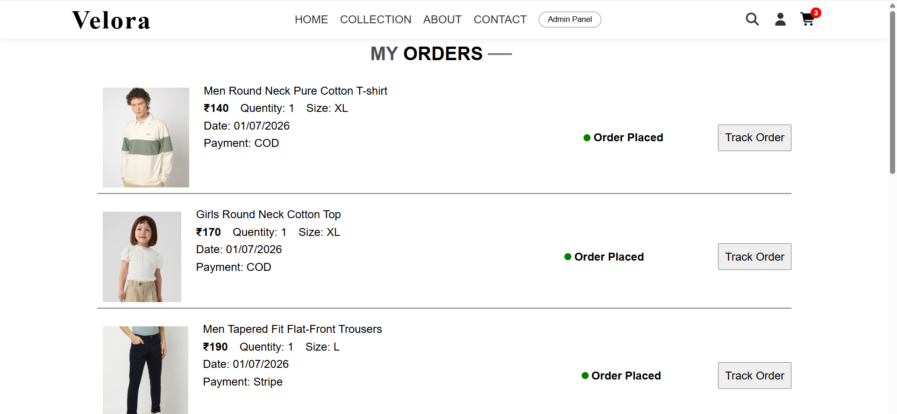
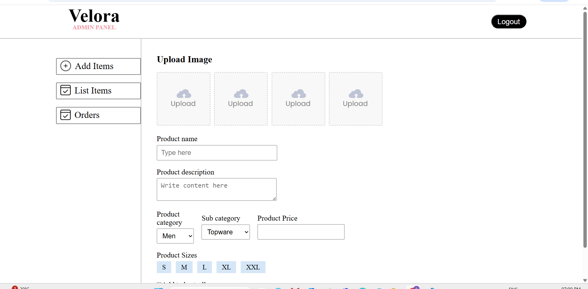
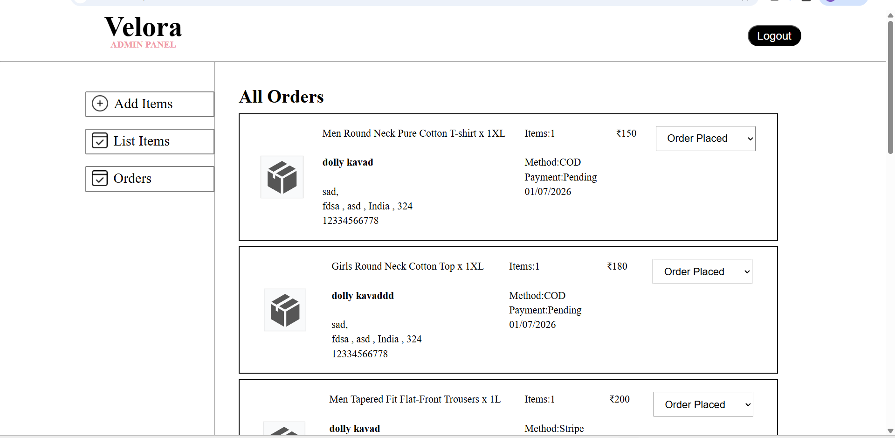

# 🛍️ Velora – Full Stack MERN Fashion E-Commerce Website

Velora is a modern Full Stack Fashion E-Commerce web application built using the MERN Stack. It provides a seamless online shopping experience with a clean, responsive user interface and a secure admin dashboard for efficient product and order management.

---

## ✨ Features

### 👤 Customer Features

- User Authentication
- Browse Products
- Product Categories
- Product Search
- Product Filters
- Product Details
- Wishlist
- Shopping Cart
- Secure Checkout
- Online Payment Integration
- Order Management
- Order Tracking
- Product Reviews & Ratings
- Responsive Design

### 🔐 Admin Features

- Secure Admin Login
- Admin Dashboard
- Add Products
- Update Products
- Delete Products
- Manage Orders
- Manage Users

---

## 🛠️ Tech Stack

### Frontend
- React.js
- HTML5
- CSS3
- JavaScript
- Axios

### Backend
- Node.js
- Express.js

### Database
- MongoDB

---

## 📂 Project Structure

text
VELORA/
├── admin/
├── Backend/
├── frontend/
└── README.md

---

## 📸 Screenshots

### 🏠 Home Page

### 👗 Products

### 📄 Product Details

### 🛒 Cart

### 📦 Order Tracking

### 🔐 Admin Dashboard

###  MANAGE STATUS

### MOBILE VIEW

---

## 🌐 Live Demo

Coming Soon...

---

## 🔒 Security

- Secure Authentication
- Protected Admin Routes
- Environment Variables for Sensitive Data
- MongoDB Database Security

---

## 🚀 Future Improvements

- Email Notifications
- Discount & Coupon System
- Sales Analytics Dashboard
- Multi-language Support
- Dark Mode

---

## 👨‍💻 Developer

*Purva Kavad*

BCA Student | Aspiring Full Stack Developer

---

## ⭐ Support

If you like this project, please consider giving it a ⭐ on GitHub.